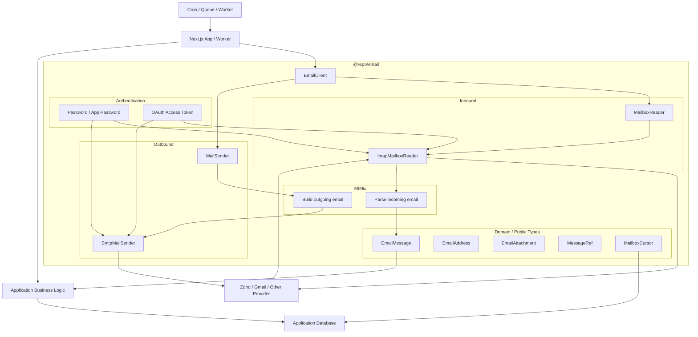

# Email Integration Package Architecture

## Overview

This document proposes an architecture for a standalone email integration package in a monorepo, intended to be consumed by a Next.js application or background worker.

The main goal is to keep the application independent of any specific email provider. The first provider may be Zoho Mail, but the architecture should allow switching to Gmail or another provider later with minimal changes.

The package should therefore expose provider-neutral email concepts while hiding IMAP, SMTP, Zoho, Gmail, and third-party library details.

---

## Goals

The package should:

- Receive email from a mailbox.
- Send email.
- Normalize provider-specific messages into a common application-facing format.
- Support mailbox operations such as marking messages read, moving them, or deleting them.
- Support incremental mailbox synchronization.
- Allow authentication using passwords/app passwords or OAuth.
- Hide IMAP/SMTP implementation details from the rest of the application.
- Make switching from Zoho to Gmail mostly a configuration/authentication change.

The package should **not**:

- Own application database persistence.
- Know about customers, tickets, orders, workflows, or other business concepts.
- Own cron jobs, queues, or polling schedules.
- Expose IMAP UIDs, SMTP concepts, ImapFlow types, Nodemailer types, or provider-specific types.

---

## High-Level Architecture



The important dependency boundary is:

```text
Application
    ↓
@repo/email public API
    ↓
provider-neutral email types
    ↓
IMAP / SMTP adapters
    ↓
Zoho today, Gmail later
```

---

## Public API

The package should expose a small, provider-neutral API.

A possible starting point:

```ts
export interface EmailClient {
  inbox: MailboxReader;

  send(input: SendEmailInput): Promise<SendEmailResult>;

  close(): Promise<void>;
}
```

The inbox capability could be:

```ts
export interface MailboxReader {
  sync(options?: SyncMailboxOptions): Promise<SyncMailboxResult>;

  get(ref: MessageRef): Promise<EmailMessage>;

  markRead(ref: MessageRef): Promise<void>;

  markUnread(ref: MessageRef): Promise<void>;

  move(ref: MessageRef, destinationFolder: string): Promise<MessageRef>;

  delete(ref: MessageRef): Promise<void>;
}
```

The main factory would be:

```ts
export function createEmailClient(config: EmailConfig): EmailClient;
```

Example usage:

```ts
const email = createEmailClient(config);

const result = await email.inbox.sync({
  cursor: previousCursor,
});

await email.send({
  to: [{ address: 'alice@example.com' }],
  subject: 'Hello',
  text: 'Hi Alice',
});

await email.close();
```

The application should not need to know whether `sync()` uses IMAP, the Gmail API, or something else internally.

---

## Public Types

The package should define its own normalized types.

Important public types include:

```text
EmailMessage
EmailAddress
EmailAttachment
MessageRef
MailboxCursor
SendEmailInput
SendEmailResult
EmailError
```

### EmailMessage

A normalized incoming message could look like:

```ts
export interface EmailMessage {
  ref: MessageRef;

  messageId?: string;

  from: EmailAddress;

  to: EmailAddress[];
  cc: EmailAddress[];
  bcc?: EmailAddress[];

  replyTo?: EmailAddress[];

  subject?: string;

  text?: string;
  html?: string;

  receivedAt?: Date;
  sentAt?: Date;

  attachments: EmailAttachment[];

  flags: {
    read: boolean;
    flagged: boolean;
    answered: boolean;
  };

  headers: Record<string, string | string[]>;
}
```

### EmailAddress

```ts
export interface EmailAddress {
  name?: string;
  address: string;
}
```

### MessageRef

The application needs a way to refer back to a remote message, but it should not know about IMAP UIDs or Gmail message IDs.

Use an opaque type:

```ts
export type MessageRef = string & {
  readonly __brand: 'MessageRef';
};
```

Internally, the implementation may encode provider-specific details such as:

```text
folder
UID
UIDVALIDITY
```

or a Gmail message ID.

The application only uses the reference:

```ts
await email.inbox.markRead(message.ref);
```

---

## Incremental Synchronization

The main inbound operation should be `sync()`, not `getUnreadMessages()`.

Unread status is not a reliable way to detect new messages because another mail client may mark a message as read before the application sees it.

Instead:

```ts
const result = await email.inbox.sync({
  cursor: previousCursor,
});
```

The result contains:

```ts
export interface SyncMailboxResult {
  messages: EmailMessage[];
  cursor: MailboxCursor;
  hasMore: boolean;
}
```

The application persists the cursor and passes it into the next sync.

Conceptually:

```text
previous cursor
      ↓
email.inbox.sync()
      ↓
messages since previous sync
      ↓
new cursor
```

`MailboxCursor` should also be opaque so the application does not depend on IMAP-specific synchronization details.

---

## Internal Modules

A reasonable package structure is:

```text
packages/email/
│
├── src/
│   ├── index.ts
│   │
│   ├── client/
│   │   ├── create-email-client.ts
│   │   └── email-client.ts
│   │
│   ├── domain/
│   │   ├── message.ts
│   │   ├── address.ts
│   │   ├── attachment.ts
│   │   ├── message-ref.ts
│   │   └── mailbox-cursor.ts
│   │
│   ├── inbound/
│   │   ├── mailbox-reader.ts
│   │   └── imap/
│   │       ├── imap-mailbox-reader.ts
│   │       ├── imap-connection.ts
│   │       ├── imap-sync.ts
│   │       ├── imap-message-ref.ts
│   │       └── imap-cursor.ts
│   │
│   ├── outbound/
│   │   ├── mail-sender.ts
│   │   └── smtp/
│   │       ├── smtp-mail-sender.ts
│   │       └── smtp-connection.ts
│   │
│   ├── mime/
│   │   ├── parse-message.ts
│   │   └── build-message.ts
│   │
│   ├── auth/
│   │   ├── email-auth.ts
│   │   ├── password-auth.ts
│   │   └── oauth-auth.ts
│   │
│   ├── config/
│   │   ├── schema.ts
│   │   └── normalize-config.ts
│   │
│   └── errors/
│       ├── email-error.ts
│       ├── authentication-error.ts
│       └── connection-error.ts
│
└── package.json
```

---

## Internal Responsibilities

### Domain

Contains provider-neutral data structures such as:

```text
EmailMessage
EmailAddress
EmailAttachment
MessageRef
MailboxCursor
```

This layer should not depend on IMAP, SMTP, ImapFlow, Nodemailer, Zoho, or Gmail.

### Inbound

Responsible for reading and manipulating mailbox messages.

The first implementation would likely be:

```text
MailboxReader
    ↓
ImapMailboxReader
    ↓
ImapFlow
```

Only this layer should understand IMAP concepts such as UIDs, UIDVALIDITY, FETCH, STORE, folders, and connection state.

### Outbound

Responsible for sending email.

The first implementation would likely be:

```text
MailSender
    ↓
SmtpMailSender
    ↓
Nodemailer
```

SMTP and Nodemailer details should stay internal.

### MIME

Responsible for the contents of actual email messages.

Inbound:

```text
IMAP
 ↓
raw RFC/MIME message
 ↓
MIME parser
 ↓
EmailMessage
```

Outbound:

```text
SendEmailInput
 ↓
MIME construction
 ↓
SMTP
```

This should remain conceptually separate from the transport layer.

### Authentication

The transport layer should support at least:

```text
Password / App Password
OAuth2
```

For OAuth, the email package should preferably receive a function that provides an access token rather than owning the complete Google or Zoho OAuth flow.

For example:

```ts
auth: {
  type: "oauth2",
  user: "support@example.com",

  getAccessToken: async () => {
    return authService.getAccessToken();
  },
}
```

This keeps provider-specific OAuth authorization and token storage outside the email transport package.

### Errors

Third-party errors should not leak to consumers.

Expose normalized errors instead, for example:

```ts
type EmailErrorCode =
  | 'AUTHENTICATION_FAILED'
  | 'CONNECTION_FAILED'
  | 'MESSAGE_NOT_FOUND'
  | 'INVALID_MESSAGE'
  | 'MAILBOX_UNAVAILABLE'
  | 'SEND_FAILED'
  | 'RATE_LIMITED'
  | 'UNKNOWN';
```

This allows application code to handle failures without depending on ImapFlow, Nodemailer, Zoho, or Gmail error types.

---

## Configuration

Configuration should primarily describe protocols and capabilities rather than hard-coding providers.

For example:

```ts
createEmailClient({
  inbound: {
    type: 'imap',
    host: process.env.EMAIL_IMAP_HOST!,
    port: 993,
    secure: true,
    auth: {
      type: 'password',
      user: process.env.EMAIL_USERNAME!,
      password: process.env.EMAIL_PASSWORD!,
    },
  },

  outbound: {
    type: 'smtp',
    host: process.env.EMAIL_SMTP_HOST!,
    port: 465,
    secure: true,
    auth: {
      type: 'password',
      user: process.env.EMAIL_USERNAME!,
      password: process.env.EMAIL_PASSWORD!,
    },
  },
});
```

Switching from Zoho to Gmail would then mostly involve changing:

- IMAP host.
- SMTP host.
- Authentication configuration.

The application-facing interface stays the same.

Optional provider presets can be added later, for example:

```ts
import { zohoMailConfig } from '@repo/email/providers/zoho';
```

These should remain convenience helpers rather than the core architecture.

---

## What Stays Outside the Package

### Database persistence

The package should return messages. The application decides whether and how to store them.

Good:

```ts
const result = await email.inbox.sync({
  cursor: syncState.cursor,
});

for (const message of result.messages) {
  await saveEmail(message);
}

await saveSyncCursor(result.cursor);
```

Avoid:

```ts
await email.syncAndSaveToDatabase();
```

### Scheduling

The package should not start polling loops or cron jobs.

Scheduling belongs to the application infrastructure:

```text
Vercel Cron / Worker / Queue
            ↓
      syncEmailJob()
            ↓
        @repo/email
```

This keeps the package usable from Next.js route handlers, workers, CLI scripts, queues, or other runtimes.

### Business logic

The package should not know whether an email represents:

- A customer reply.
- A support ticket.
- An order.
- An invoice.
- A workflow trigger.

That interpretation belongs to the consuming application.

---

## Implementation Style

Use different constructs for different kinds of responsibilities:

```text
Pure transformation
    → function

Network connection / lifecycle / state
    → class

Architectural capability
    → interface
```

Examples:

```ts
// Good candidates for classes
class ImapConnection {}
class ImapMailboxReader {}
class SmtpMailSender {}
class DefaultEmailClient {}
```

```ts
// Good candidates for functions
parseEmail(...)
encodeMailboxCursor(...)
decodeMailboxCursor(...)
normalizeAddress(...)
```

The goal is to avoid unnecessary class-heavy design while still using classes where lifecycle and state make them useful.

---

## Dependency Direction

The intended dependency flow is:

```text
                  domain
                    ▲
                    │
          ┌─────────┴─────────┐
          │                   │
       inbound             outbound
          ▲                   ▲
          │                   │
        IMAP                 SMTP
          │                   │
      ImapFlow             Nodemailer
```

The domain model must not depend on transport libraries.

Likewise, the main application should depend only on the public API of `@repo/email`.

---

## Recommended Initial Scope

Start with a deliberately small public surface:

```ts
export interface EmailClient {
  inbox: {
    sync(options?: SyncMailboxOptions): Promise<SyncMailboxResult>;

    get(ref: MessageRef): Promise<EmailMessage>;

    markRead(ref: MessageRef): Promise<void>;

    markUnread(ref: MessageRef): Promise<void>;

    move(ref: MessageRef, destination: string): Promise<MessageRef>;

    delete(ref: MessageRef): Promise<void>;
  };

  send(message: SendEmailInput): Promise<SendEmailResult>;

  close(): Promise<void>;
}
```

And:

```ts
export function createEmailClient(config: EmailConfig): EmailClient;
```

This is enough to support Zoho through IMAP/SMTP today while preserving the option to use Gmail IMAP/SMTP or even a provider API later.

---

## Key Design Principles

1. **Expose email concepts, not protocol concepts.**
2. **Keep provider details behind adapters.**
3. **Normalize incoming and outgoing email types.**
4. **Use opaque references and cursors to hide provider-specific identifiers.**
5. **Use synchronization cursors rather than unread status for reliable inbound processing.**
6. **Keep persistence, scheduling, and business logic outside the package.**
7. **Treat Zoho and Gmail as implementations/configurations, not as the architecture itself.**

The most important parts to define carefully before implementation are the `EmailClient` interface, the normalized `EmailMessage` type, and the exact semantics of `inbox.sync()` and `MailboxCursor`.
